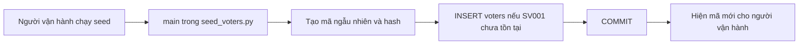

# 1. Chuẩn bị cử tri và mã kích hoạt

**Ví dụ:** Người vận hành chạy script nạp dữ liệu giả; `SV001` chưa có trong hệ thống. Đây là bước cấp tài khoản trước, nên trang web không có chức năng tự đăng ký một cử tri bất kỳ.

1. `app/database/seed_voters.py:main()` có danh sách cử tri giả. Hàm tạo mã kích hoạt bằng `secrets.token_urlsafe(32)` và gọi `hash_activation_code()` để lấy bản băm. Bản băm là giá trị dùng để đối chiếu mã, không phải mã gốc.
2. Trong một transaction bằng `AppSession` của role DB `app_user`, script thử thêm `SV001` vào bảng `voters`: `voter_id`, `full_name`, `activation_hash`, `activated = false`. Các cột `password_hash`, `salt`, `public_key` ban đầu là `NULL`.
3. `ON CONFLICT DO NOTHING` giữ nguyên cử tri đã có. Chạy lại seed không cấp mã mới cho `SV001` đã tồn tại và không đặt lại tài khoản đã kích hoạt.
4. Sau khi commit, script mới in mã của **cử tri vừa thêm** cho người vận hành cấp riêng. Không có response HTTP. Nếu transaction lỗi, không in mã như thể đã cấp thành công.

**Chưa có ở bước này:** chưa tạo cặp khóa cử tri, chưa tạo dòng `voter_status`, chưa ghi phiếu. Khóa cử tri sẽ được tạo trong trình duyệt khi kích hoạt.

**Code:** [seed_voters.py](../app/database/seed_voters.py), [auth.py](../app/auth/auth.py), [models.py](../app/database/models.py). **Kiểm tra:** [test_seed_voters.py](../tests/test_seed_voters.py); checkpoint PostgreSQL riêng trong [test_stage4_postgres.py](../tests/test_stage4_postgres.py).
