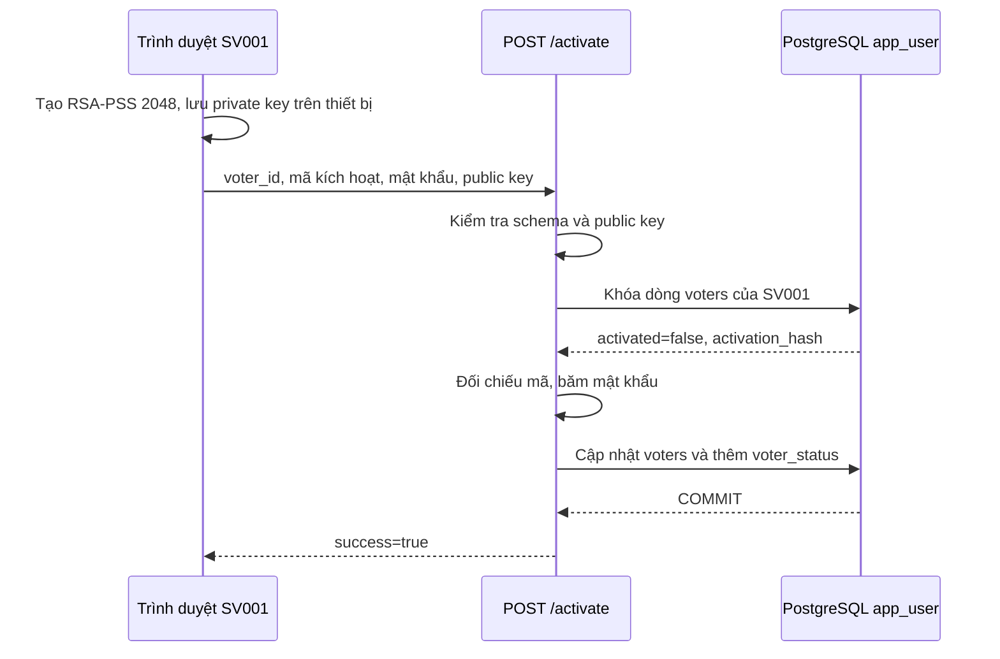

# 2. Kích hoạt tài khoản (“đăng ký” trong giao diện)

**Ví dụ:** `SV001` đã được nạp vào `voters` và nhận mã kích hoạt. Cử tri mở `/static/register.html`, điền mã cử tri, mã kích hoạt và mật khẩu mới. Trang này kích hoạt tài khoản có sẵn; nó không tạo cử tri tùy ý.

1. `static/js/activate.js` gọi `loadPublicKeyPem()` và `loadPrivateKey()` cho `SV001`. Nếu chưa có cả hai, `generateVoterKeys()` tạo cặp khóa RSA-PSS trong trình duyệt; `saveVoterKeys()` lưu private key dạng PKCS8 trong `localStorage` và public key dạng PEM. Khi gửi lại sau lỗi mạng, trang dùng lại cặp khóa đã lưu. Thiếu một nửa cặp khóa thì báo lỗi, không âm thầm tạo cặp khác.
2. Trang gửi `POST /activate` với `voter_id`, `activation_code`, `password`, `public_key`. **Private key không có trong request.** `ActivationRequest` kiểm tra kiểu, độ dài và các trường hợp lệ; `activate()` kiểm tra public key là RSA 2048 dạng SPKI PEM.
3. `activate()` mở transaction và dùng `SELECT ... FOR UPDATE` khóa dòng `voters` của `SV001`. Hàm chỉ tiếp tục nếu tài khoản tồn tại, chưa kích hoạt và mã được `verify_activation_code()` đối chiếu đúng với `voters.activation_hash`.
4. `hash_password()` tạo `password_hash` và `salt`. Route ghi `voters.password_hash`, `voters.salt`, `voters.public_key`, đặt `voters.activated = true`, xóa `voters.activation_hash`, đồng thời thêm `voter_status` cho `SV001` với `has_voted = false`.
5. Sau commit, API trả `{"success": true}`. Trang mới hiện liên kết đăng nhập và nhắc tải bản sao khóa riêng. Nếu mã sai, đã kích hoạt hoặc khóa công khai sai, không xác nhận thành công. Lỗi trong transaction hủy cả phần cập nhật tài khoản lẫn dòng trạng thái.

**Vì sao khóa dòng?** Nếu hai yêu cầu kích hoạt của `SV001` đến cùng lúc, khóa dòng giúp chỉ một yêu cầu sử dụng mã và đặt khóa/mật khẩu thành công.

**Code:** [activate.js](../static/js/activate.js), [crypto.js](../static/js/crypto.js), [activate.py](../app/auth/activate.py), [schemas.py](../app/api/schemas.py). **Kiểm tra:** [test_activate.py](../tests/test_activate.py), [test_stage4_postgres.py](../tests/test_stage4_postgres.py).
