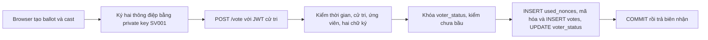

# 6. Ký, mã hóa và ghi một phiếu

**Ví dụ:** `SV001` chọn ứng viên B (`candidate_id = 2`) và bấm **Ký và gửi phiếu**. `nonce` là chuỗi ngẫu nhiên 32 ký tự hex; `ts` là thời điểm Unix tính bằng giây. Hai giá trị này có cùng nội dung ở hai thông điệp ký.



## 1. Trình duyệt chuẩn bị và ký

`static/js/vote.js` nạp private key của `SV001` từ `localStorage`; thiếu khóa thì yêu cầu nhập file sao lưu. Trang tạo:

```text
ballot = {candidate_id: 2, nonce: <hex ngẫu nhiên>, ts: <giây Unix>}
cast   = {election_id: <mã cuộc bầu cử>, voter_id: "SV001", nonce: <cùng nonce>, ts: <cùng ts>}
```

`signPayload()` chuẩn hóa JSON (sắp khóa, không khoảng trắng, UTF-8) rồi ký **hai lần** bằng RSA-PSS/SHA-256 của cử tri: `sig_ballot` xác nhận lựa chọn, `sig_cast` xác nhận hành động bỏ phiếu cho `SV001` trong cuộc bầu cử này. Request `POST /vote` gồm `ballot`, hai chữ ký Base64 và header `Authorization: Bearer <JWT>`. `cast` không được gửi như một field riêng; backend dựng lại nó từ JWT, cấu hình và ballot.

## 2. Backend kiểm tra

`VoteRequest` kiểm tra cấu trúc JSON, nonce, kiểu số và Base64. `require_voter()` kiểm JWT role cử tri và lấy `SV001`. `vote.py:vote()` mở transaction, rồi `voting_service.py:cast_vote()`:

1. Kiểm giờ hiện tại nằm trong khoảng bầu cử; `ts` không quá cũ hoặc ở tương lai vượt ngưỡng cấu hình.
2. Đọc `voters` để xác nhận `SV001` đã kích hoạt và có public key; đọc `candidates` để xác nhận ứng viên 2 tồn tại.
3. Dựng lại `cast`, giải mã chữ ký Base64 và dùng `voters.public_key` xác minh cả `sig_ballot` lẫn `sig_cast`. Private key cử tri không vào backend.
4. Dùng `SELECT ... FOR UPDATE` khóa dòng `voter_status` của `SV001`, kiểm `has_voted = false`. Khóa dòng làm hai yêu cầu đồng thời của cùng cử tri không thể cùng vượt qua kiểm tra này.

## 3. Ghi DB trong cùng transaction

| Bảng | Thay đổi |
| --- | --- |
| `used_nonces` | `INSERT nonce`; khóa chính chặn dùng lại nonce. |
| `votes` | `INSERT vote_id`, `ciphertext`, `wrapped_dek`, `iv`, `tag`. Không có `voter_id` hoặc `candidate_id` riêng. |
| `voter_status` | `UPDATE has_voted = true`, `sig_cast`, `receipt_hash`, `voted_at`. Không có lựa chọn ứng viên. |

Trước khi thêm `votes`, `cast_vote()` gói `ballot` và `sig_ballot` thành JSON. `encrypt_vote()` tạo khóa AES-256 mới và IV mới cho phiếu, mã hóa bằng AES-GCM, rồi KMS mô phỏng dùng RSA-OAEP bọc khóa AES. Chỉ bốn phần dữ liệu mã hóa được lưu trong `votes`. Backend **thấy lựa chọn ứng viên trước khi mã hóa**.

Biên nhận là SHA-256 của **bytes chữ ký `sig_cast`**, biểu diễn bằng hex. `vote.py` chỉ trả `{"success":true,"receipt":"<hex>"}` sau khi transaction commit. Nếu một thao tác trước commit lỗi, toàn bộ ba thay đổi cùng rollback. Bầu lại bị chặn 409; nonce trùng bị chặn 409. Nếu mất kết nối sau lúc server đã commit, trình duyệt không thể kết luận phiếu chưa được ghi; giao diện cảnh báo trạng thái chưa chắc chắn.

**Giới hạn:** Biên nhận hiện tại không phải bằng chứng kiểm phiếu đầu cuối. Phần `votes` và `voter_status` tách bảng để giảm liên kết trực tiếp, nhưng không chứng minh ẩn danh tuyệt đối.

**Code:** [vote.js](../static/js/vote.js), [vote.py](../app/voting/vote.py), [voting_service.py](../app/voting/voting_service.py), [crypto_service.py](../app/crypto/crypto_service.py), [kms.py](../app/crypto/kms.py). **Kiểm tra:** [test_voting.py](../tests/test_voting.py), [test_attack.py](../tests/test_attack.py).
