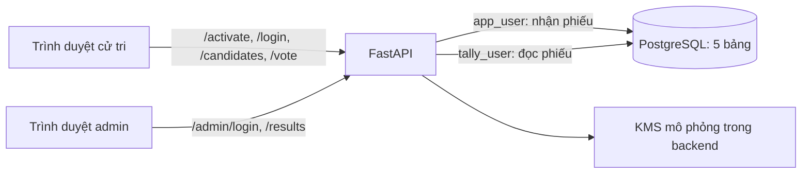

# hệ thống bầu cử điện tử


## 1. Mục tiêu và phạm vi

Hệ thống minh họa một cuộc bầu cử: người vận hành nạp sẵn cử tri; cử tri kích hoạt tài khoản, đăng nhập, ký và gửi một phiếu; sau giờ kết thúc, quản trị viên xem **tổng phiếu theo ứng viên**. Trang tên `register.html` thực hiện **kích hoạt cử tri đã có**, không cho người lạ tự đăng ký.

**Lời nói gợi ý:** “Nhóm em xây một bản demo bầu cử điện tử để học cách nối giao diện, API, PostgreSQL và mật mã. Một cử tri được bỏ phiếu tối đa một lần. Kết quả chỉ hiển thị sau thời điểm kết thúc. Em sẽ giải thích bằng ví dụ cử tri SV001 chọn ứng viên B.”

## 2. Công nghệ được dùng

| Thành phần       | Công nghệ                                                  | Vai trò trong dự án                                                                                  |
| ---------------- | ---------------------------------------------------------- | ---------------------------------------------------------------------------------------------------- |
| Giao diện        | HTML, CSS, JavaScript; Web Crypto API của trình duyệt      | Bốn trang kích hoạt, đăng nhập, bỏ phiếu, quản trị; tạo khóa RSA và ký ở phía cử tri.                |
| Backend          | Python, FastAPI, Uvicorn, Pydantic                         | Nhận sáu API, kiểm tra dữ liệu JSON, xác thực và điều phối nghiệp vụ.                                |
| Database         | PostgreSQL trong Docker; SQLAlchemy async và `asyncpg`     | Lưu năm bảng; transaction và khóa dòng khi bỏ phiếu. Docker chỉ chạy PostgreSQL; backend chạy local. |
| Xác thực         | PBKDF2-HMAC-SHA256 với salt riêng; JWT ký HS256            | Lưu hash mật khẩu, cấp token có hạn và phân biệt quyền cử tri/admin.                                 |
| Chữ ký và mã hóa | RSA-PSS, AES-256-GCM, RSA-OAEP qua thư viện `cryptography` | Cử tri ký hai nội dung; backend mã hóa phiếu; KMS mô phỏng bọc khóa AES của từng phiếu.              |
| Kiểm tra         | `unittest`, PostgreSQL thử nghiệm riêng, Playwright        | Kiểm tra logic, quyền DB, bỏ phiếu đồng thời và một luồng trình duyệt demo.                          |

**Lời nói gợi ý:** “Trình duyệt tạo cặp khóa cử tri bằng Web Crypto API. Python/FastAPI kiểm tra yêu cầu và dùng PostgreSQL để lưu dữ liệu. Chữ ký chứng minh phiếu được ký bằng khóa của cử tri; mã hóa bảo vệ nội dung phiếu khi lưu DB. Hai việc này khác nhau.”

## 3. Sơ đồ tổng quan



`app/main.py` gắn sáu API và phục vụ bốn trang trong `static/`. Database có ba role: `app_user` phục vụ kích hoạt, đăng nhập, đọc ứng viên và ghi phiếu; `tally_user` đọc phiếu để kiểm; `admin_app` theo quyền SQL hiện tại chỉ đọc ứng viên. Tài khoản **admin của API** được đối chiếu từ cấu hình, không phải một dòng trong bảng admin và không dùng `admin_app` để đọc phiếu.

## 4. Luồng SV001 từ kích hoạt đến bỏ phiếu

### Bước 1 — Cấp mã và kích hoạt

Người vận hành dùng `seed_voters.py` thêm `SV001` vào `voters` với `activated = false` và **hash của mã kích hoạt**. Trên `register.html`, `SV001` nhập mã kích hoạt và mật khẩu mới. Chỉ khi bấm nút, trình duyệt mới tạo cặp RSA-PSS và lưu **cả hai khóa** vào `localStorage`, rồi gửi **chỉ public key** cùng form tới `POST /activate`.

Backend kiểm mã kích hoạt, kiểm public key, khóa dòng `voters` để chống kích hoạt đồng thời; nếu hợp lệ thì ghi `password_hash`, `salt`, `public_key`, đặt `activated = true`, xóa hash mã kích hoạt và thêm dòng `voter_status` với `has_voted = false`. Chỉ trả thành công sau commit. **Khóa được tạo trước lúc server xác nhận mã đúng**; nếu mã sai, DB không lưu public key nhưng cặp khóa đã tạo vẫn nằm trong trình duyệt để thử lại. Cử tri nên tải file sao lưu private key; nếu đổi thiết bị, đăng nhập rồi nhập file ở trang bỏ phiếu.

### Bước 2 — Đăng nhập và xem ứng viên

`POST /login` đọc `voters` để kiểm `SV001` đã kích hoạt và mật khẩu khớp hash. Thành công, backend cấp **JWT** có role `voter`, `election_id` và hạn dùng theo cấu hình (mặc định 60 phút). Trình duyệt giữ JWT trong `sessionStorage` của tab, không lưu mật khẩu. `GET /candidates` đọc bảng `candidates` và hiển thị ứng viên B. Đăng nhập và xem ứng viên không ghi phiếu.

### Bước 3 — Ký và gửi phiếu

Khi `SV001` chọn B, trình duyệt tạo `nonce` ngẫu nhiên dùng một lần và `ts` là thời điểm Unix. Nó dùng private key của `SV001` ký **hai nội dung**:

```text
ballot = {candidate_id: 2, nonce: <32 ký tự hex>, ts: <giây Unix>}
cast   = {election_id: <mã bầu cử>, voter_id: "SV001", nonce: <cùng nonce>, ts: <cùng ts>}
```

`ballot` ghi lựa chọn ứng viên; `cast` xác nhận `SV001` gửi phiếu cho đúng cuộc bầu cử. Request `POST /vote` gửi `ballot`, chữ ký `sig_ballot`, chữ ký `sig_cast` và JWT. **Private key và object `cast` không được gửi.** Backend lấy danh tính từ JWT, dựng lại `cast` rồi dùng `voters.public_key` để kiểm hai chữ ký.

Backend còn kiểm thời gian, tài khoản, ứng viên, `voter_status.has_voted` dưới khóa dòng và nonce chưa dùng. Trong **một transaction**, backend thêm nonce vào `used_nonces`, mã hóa `{ballot, sig_ballot}` rồi thêm dữ liệu mã hóa vào `votes`, cập nhật `voter_status.has_voted = true` cùng `sig_cast` và `receipt_hash`. Lỗi ở giữa làm rollback cả ba thay đổi; chỉ sau commit mới trả biên nhận. `receipt_hash` là SHA-256 của bytes `sig_cast`, được trả dưới dạng hex. Nó **chưa phải bằng chứng phiếu đã được tính vào kết quả cuối cùng**.

**Lời nói gợi ý:** “Một chữ ký xác nhận lựa chọn B, chữ ký còn lại xác nhận SV001 thực hiện hành động bỏ phiếu. Public key trên server kiểm tra hai chữ ký. Database khóa dòng trạng thái để hai yêu cầu gửi đồng thời của SV001 không cùng thành công. Nonce chặn gửi lại cùng yêu cầu cũ; `has_voted` chặn SV001 bầu lần nữa kể cả với nonce mới.”

## 5. Lưu dữ liệu và kiểm phiếu

| Bảng           | Dữ liệu chính                                                    | Vai trò trong ví dụ                                                             |
| -------------- | ---------------------------------------------------------------- | ------------------------------------------------------------------------------- |
| `voters`       | Mã cử tri, hash mật khẩu, salt, public key, trạng thái kích hoạt | Xác thực `SV001` và kiểm chữ ký. Không lưu private key cử tri.                  |
| `candidates`   | Mã và tên ứng viên                                               | Trả danh sách cho trang bỏ phiếu; đối chiếu ứng viên B.                         |
| `voter_status` | `has_voted`, `sig_cast`, `receipt_hash`, thời điểm               | Chặn bầu lần hai và lưu trạng thái/biên nhận của `SV001`; không lưu lựa chọn B. |
| `used_nonces`  | Nonce đã dùng, `used_at`                                         | Khóa chính nonce chặn dùng lại; `used_at` ghi thời điểm DB nhận mã.             |
| `votes`        | Phiếu mã hóa, khóa AES đã bọc, IV, tag                           | Lưu phiếu mà không có cột `voter_id` hoặc `candidate_id` riêng.                 |

Backend **thấy lựa chọn B trước khi mã hóa**. Mỗi phiếu được mã hóa bằng một khóa AES-256 mới; public key của KMS mô phỏng bọc khóa AES bằng RSA-OAEP. Khóa KMS khác cặp RSA-PSS của cử tri. Sau giờ kết thúc, admin đăng nhập bằng `POST /admin/login` và gọi `GET /results` với JWT role `admin`. `tally_user` đọc `votes` và `candidates`; backend dùng private key KMS giải mã trong RAM, đếm theo ứng viên và **chỉ trả tổng**. Trước giờ kết thúc, API từ chối xem kết quả.

**Lời nói gợi ý:** “Việc tách `voter_status` và `votes` tránh một cột nối trực tiếp cử tri với lá phiếu, nhưng không thể kết luận hệ thống ẩn danh tuyệt đối. Kết quả admin nhận được chỉ là tổng số phiếu theo ứng viên.”

## 6. Minh chứng kiểm tra và giới hạn cần nói rõ

Theo checkpoint trong [ROADMAP.md](../ROADMAP.md), dự án đã thử: mã kích hoạt sai và kích hoạt đồng thời; mật khẩu/JWT sai; hai chữ ký sai; nonce lặp; hai request bỏ phiếu đồng thời; lỗi giữa transaction phải rollback; quyền DB; chặn xem kết quả trước giờ; và một luồng trình duyệt trên DB thử nghiệm riêng. Khi thuyết trình, có thể trình diễn **trên dữ liệu giả/DB thử nghiệm**: kích hoạt → đăng nhập → chọn B → bầu lần đầu thành công → bầu lại bị chặn → admin xem tổng sau giờ kết thúc. Không cần xóa DB hoặc tạo lại KMS để trình diễn.

**Những giới hạn của bản demo:** backend nhìn thấy lựa chọn trước khi mã hóa; KMS mô phỏng nằm cùng backend; tách bảng không bảo đảm ẩn danh tuyệt đối; biên nhận chưa cho cử tri tự kiểm chứng phiếu đã được đếm; private key cử tri ở `localStorage` và file sao lưu có rủi ro nếu bị lộ; khôi phục khóa trên thiết bị mới, tải lớn và vận hành bảo mật thực tế chưa được kiểm chứng. JWT bị lấy cắp có thể dùng như phiên đăng nhập tới khi hết hạn; riêng bỏ phiếu còn đòi chữ ký từ private key.

**Lời nói kết:** “Demo đã chứng minh các luồng đã thử trên dữ liệu giả, đặc biệt là kiểm chữ ký, transaction và chặn bầu hai lần. Nó chưa đáp ứng yêu cầu để vận hành một cuộc bầu cử thật. Hướng phát triển là kiểm chứng khôi phục khóa, đối soát biên nhận, bảo vệ khóa KMS và đánh giá bảo mật độc lập.”

## Câu hỏi thầy có thể hỏi

- **Vì sao cần salt cho mật khẩu?** Hai cử tri dùng cùng mật khẩu vẫn có hash khác nhau; PBKDF2 làm việc thử đoán mật khẩu tốn thời gian hơn. Salt không phải bí mật và không làm mật khẩu yếu trở thành mạnh.
- **Public key dùng làm gì?** Kiểm chữ ký do private key cử tri tạo; `has_voted` mới là cột trả lời cử tri đã bầu hay chưa.
- **Nonce dùng làm gì?** Chặn dùng lại một yêu cầu bỏ phiếu cũ; `used_nonces.nonce` là khóa chính nên cùng nonce không thể ghi hai lần.
- **`sig_cast` và `receipt_hash` khác gì?** Một cột lưu chữ ký hành động gửi phiếu, cột kia lưu hash của chữ ký để làm biên nhận. Tally không dùng hai cột này để đếm.
- **Có thể đăng nhập bằng JWT bị lộ không?** Có thể gọi API như người đã đăng nhập khi token còn hạn; muốn ký phiếu hợp lệ còn cần private key tương ứng.
- **Vì sao có hai cặp RSA?** RSA-PSS của cử tri dùng ký; RSA-OAEP của KMS dùng bọc/mở khóa AES của phiếu. Private key cử tri không nằm ở backend.
- **Vì sao chưa thể dùng thật?** Các giới hạn về ẩn danh, quản lý khóa, biên nhận, bảo mật triển khai và kiểm thử chưa được giải quyết đầy đủ.

## Nơi đối chiếu khi chuẩn bị slide

- [Sơ đồ các luồng chi tiết](../Sodoluong/README.md), [hợp đồng API và DB](STRUCTURE.md), [kỹ thuật mật mã/transaction](technical.md), [giới hạn](risk-analysis.md).
- Code vào [app/main.py](../app/main.py), frontend trong [static/](../static/), SQL trong [db/init.sql](../db/init.sql), test trong [tests/](../tests/).

Tài liệu này tổng hợp từ code và checkpoint hiện có; khi demo trên máy lớp, cần kiểm tra lại trạng thái DB, giờ bầu cử và URL đang chạy bằng dữ liệu giả.
