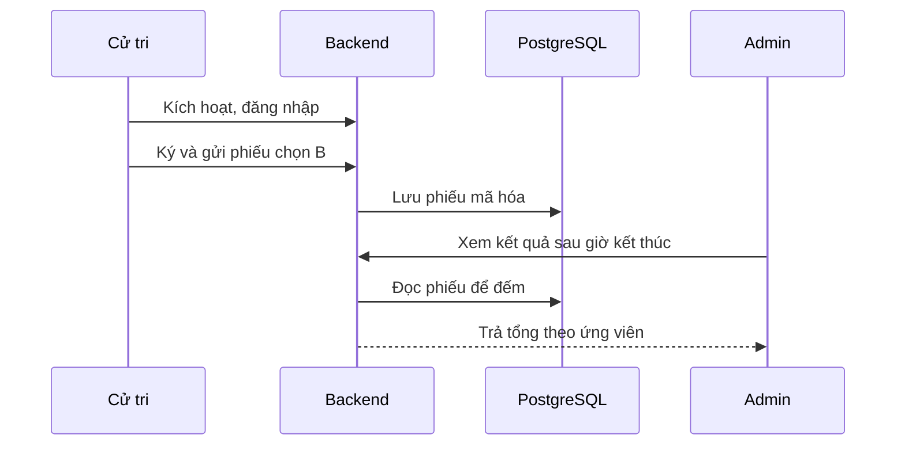
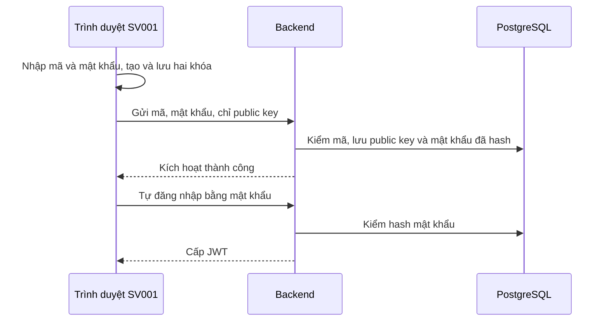
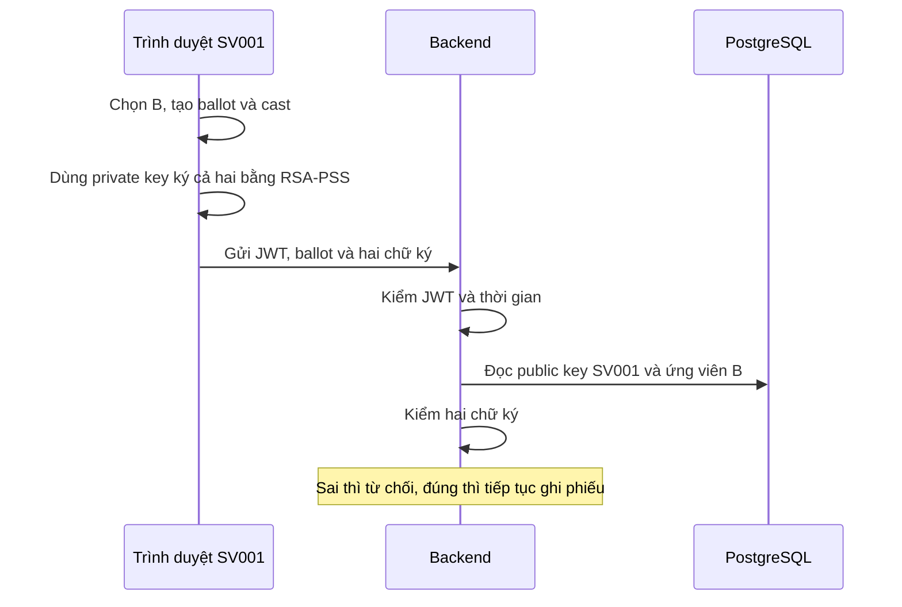
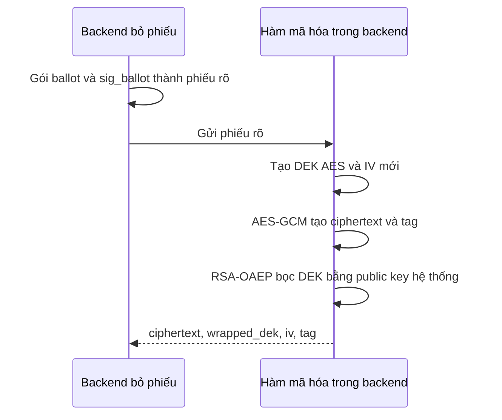
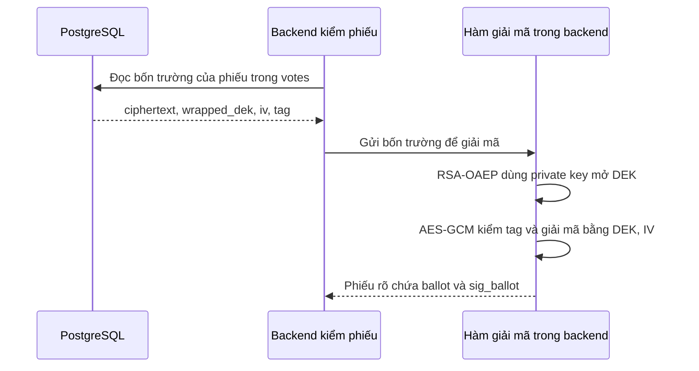
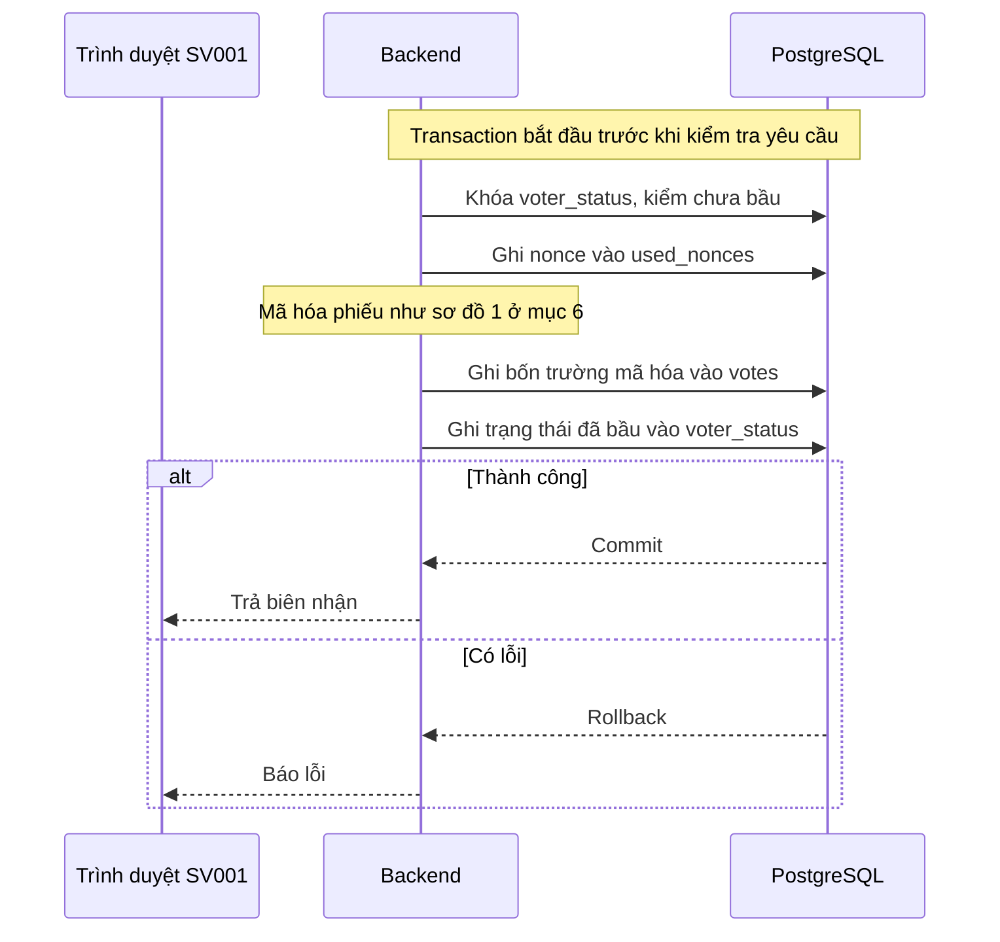
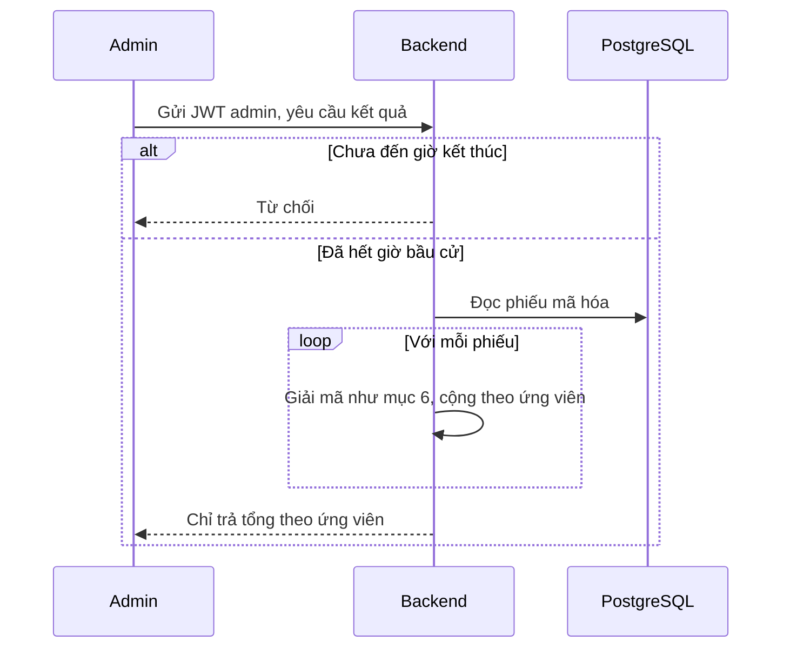

# Bài thuyết trình: Hệ thống bầu cử điện tử

**Cách dùng:** Mở file ở chế độ xem trước Markdown có hỗ trợ Mermaid để thấy các ô và mũi tên của `sequenceDiagram`, rồi đọc lần lượt các đoạn **Em trình bày**. Không cần đọc từng ký hiệu trên sơ đồ. Toàn bài theo một ví dụ giả: cử tri `SV001` chọn ứng viên B (`candidate_id = 2`). Không đưa mã kích hoạt, mật khẩu, JWT hay khóa riêng thật lên màn hình lớp.

**Hệ thống dùng mô hình gì?** Hệ thống mô phỏng mô hình **KMS (Key Management System, hệ thống quản lý khóa)** để bảo vệ khóa mã hóa phiếu. Mỗi phiếu có một khóa AES riêng gọi là DEK. Backend dùng public key của cặp khóa KMS để bọc DEK trước khi lưu vào database; khi kiểm phiếu, private key của cặp khóa đó mở DEK để giải mã. Trong bài này, KMS là module và thư mục khóa **nằm trong backend**, chưa phải dịch vụ độc lập. Việc xác thực cử tri là luồng khác: mã kích hoạt, mật khẩu, JWT và chữ ký RSA-PSS.

## 1. Mục tiêu của đề tài

**Sơ đồ tổng quan:**

**Em trình bày:** “Đây là sơ đồ tổng quan của hệ thống; em xin đọc từ trên xuống. Đầu tiên, cử tri SV001 kích hoạt tài khoản và đăng nhập. Tiếp theo, SV001 chọn ứng viên B rồi gửi phiếu. Hệ thống kiểm tra và lưu phiếu dưới dạng đã mã hóa trong database. Sau khi cuộc bầu cử kết thúc, admin yêu cầu xem kết quả; hệ thống đọc các phiếu để đếm và chỉ trả tổng theo ứng viên. Ở các sơ đồ sau, em sẽ giải thích từng bước này diễn ra như thế nào.”

## 2. Công nghệ và nhiệm vụ của từng phần

| Phần                    | Công nghệ                      | Công việc                                                  |
| ----------------------- | ------------------------------ | ---------------------------------------------------------- |
| Giao diện               | HTML, CSS, JavaScript          | Bốn trang: kích hoạt, đăng nhập, bỏ phiếu, quản trị.       |
| Mật mã trên trình duyệt | Web Crypto API                 | Tạo cặp khóa RSA-PSS của cử tri và ký trước khi gửi phiếu. |
| Backend                 | Python, FastAPI                | Nhận API, kiểm JSON, xác thực và thực hiện nghiệp vụ.      |
| Database                | PostgreSQL, SQLAlchemy         | Lưu dữ liệu bầu cử                                         |
| Xác thực                | PBKDF2-HMAC-SHA256 với salt    | Lưu hash mật khẩu, cấp mã đăng nhập có hạn và kiểm role.   |
| Phiếu và khóa           | RSA-PSS, AES-256-GCM, RSA-OAEP | Ký phiếu, mã hóa phiếu và bọc khóa AES.                    |

**Em trình bày:** “Frontend gồm các trang HTML và JavaScript; backend FastAPI xử lý đăng nhập, bỏ phiếu và xem kết quả; PostgreSQL lưu dữ liệu. Trình duyệt dùng Web Crypto API để ký phiếu. Backend dùng AES-256-GCM mã hóa phiếu và RSA-OAEP theo mô hình KMS để bảo vệ khóa AES. Phần quản lý khóa nằm ngay trong backend.”

## 3. Chuẩn bị cử tri, kích hoạt và đăng nhập

**Sơ đồ kích hoạt và đăng nhập của SV001:**

**Em trình bày:** “Trước hết, script `seed_voters.py` thêm `SV001` vào bảng `voters`. Database chỉ lưu **hash của mã kích hoạt**, không lưu mã nguyên bản. Khi SV001 điền form và bấm nút, trình duyệt tạo hai khóa: private key để cử tri ký về sau, public key để backend kiểm chữ ký. Hai khóa được lưu trong `localStorage`, nhưng request chỉ gửi public key. Backend kiểm mã kích hoạt có thuộc SV001 không, kiểm khóa công khai, khóa dòng cử tri để tránh kích hoạt đồng thời, rồi lưu `password_hash`, `salt`, `public_key`, đặt `activated=true` và thêm dòng `voter_status` với `has_voted=false`. Chỉ sau commit mới báo kích hoạt thành công. Sau đó SV001 tự đăng nhập bằng mật khẩu để nhận JWT.”

**Em nhấn mạnh:** “Khóa được tạo **sau khi bấm nút**, nhưng **trước khi server xác nhận mã kích hoạt đúng**. Nếu mã sai, public key không vào database; khóa đã tạo vẫn ở trình duyệt để thử lại. Mật khẩu tối thiểu 8 **ký tự**, không bắt buộc 8 chữ số.”

**Sao lưu khóa:** Sau khi khóa đã nằm trong `localStorage`, cử tri **bấm nút tải** để tạo file sao lưu private key; file không tự tải. Nếu đổi thiết bị, cử tri đăng nhập rồi nhập file sao lưu tại trang bỏ phiếu. Private key cử tri không được gửi lên backend. Salt là giá trị ngẫu nhiên riêng cho mỗi tài khoản: hai người dùng cùng mật khẩu vẫn có hash khác nhau.

**Code đối chiếu:** [seed_voters.py](../app/database/seed_voters.py), [activate.js](../static/js/activate.js), [crypto.js](../static/js/crypto.js), [activate.py](../app/auth/activate.py).

## 4. Đăng nhập và xem ứng viên

**Em trình bày:** “Đăng nhập chỉ **đọc** bảng `voters`. Backend kiểm tài khoản đã kích hoạt và mật khẩu khớp hash. Nếu đúng, backend cấp JWT: một mã dùng để chứng minh các request sau thuộc phiên đăng nhập của SV001. JWT được ký HS256 để phát hiện nội dung bị sửa, nhưng **không được mã hóa**, nên không chứa mật khẩu hoặc private key. Token mặc định hết hạn sau 60 phút và được lưu trong `sessionStorage`. Trang bỏ phiếu gọi `/candidates` để đọc danh sách ứng viên. Đăng nhập hay xem ứng viên đều chưa ghi phiếu.”

**Nếu thầy hỏi về JWT bị lộ:** “Người có JWT còn hạn có thể gọi API như phiên đã đăng nhập. Nhưng chỉ JWT chưa đủ bỏ phiếu hợp lệ; phải có private key cử tri để tạo chữ ký. Đăng xuất xóa JWT trên trình duyệt hiện tại, không thu hồi bản token đã bị lấy cắp trước khi hết hạn.”

**Code:** [login.js](../static/js/login.js), [login.py](../app/auth/login.py), [candidates.py](../app/api/candidates.py).

## 5. Cử tri ký hai nội dung trước khi gửi

**Sơ đồ ký và kiểm phiếu chọn B:**

**Em trình bày:** “Khi SV001 chọn B và bấm gửi, browser tạo `ballot`, nghĩa là nội dung lựa chọn ứng viên 2. Browser còn tạo `cast`, nghĩa là SV001 xác nhận **hành động gửi phiếu cho cuộc bầu cử này**. `nonce` là mã ngẫu nhiên chỉ dùng một lần; `ts` là thời gian Unix tính theo giây. Hai nội dung dùng cùng nonce và ts. Browser dùng private key của SV001 và RSA-PSS ký riêng từng nội dung. Backend dùng public key đã lưu để kiểm. Nếu ai sửa lựa chọn B thành A, chữ ký ballot không còn khớp. Nếu ai chỉ lấy được JWT mà không có private key, họ không tạo được hai chữ ký hợp lệ.”

**Phân biệt:** `ballot` nói **chọn ai**; `cast` nói **ai thực hiện lần bỏ phiếu này, cho cuộc bầu cử nào**. Object `cast` không được gửi hoặc lưu nguyên dạng: backend dựng lại nó để kiểm `sig_cast`. `sig_ballot` đi cùng phiếu đã mã hóa; `sig_cast` được lưu trong `voter_status`.

**Code:** [vote.js](../static/js/vote.js), [signature_service.py](../app/crypto/signature_service.py), [voting_service.py](../app/voting/voting_service.py).

## 6. Hệ thống mã hóa và giải mã phiếu như thế nào?

**Sơ đồ 1 — Mã hóa phiếu khi SV001 bỏ phiếu:**

**Em trình bày sơ đồ mã hóa:** “SV001 chọn ứng viên B và đã ký phiếu. Sau khi kiểm chữ ký, backend gói `ballot` là nội dung chọn B với `sig_ballot` là chữ ký của nội dung đó. Phần mã hóa trong backend tạo riêng cho phiếu này một khóa AES 32 byte gọi là DEK và một IV 12 byte. AES-256-GCM dùng chúng để tạo `ciphertext` là phiếu đã mã hóa và `tag` để phát hiện dữ liệu bị sửa. Sau đó RSA-OAEP dùng public key của hệ thống bọc DEK thành `wrapped_dek`. Backend nhận bốn giá trị `ciphertext`, `wrapped_dek`, `iv`, `tag` để lưu vào bảng `votes`. DEK gốc không được lưu.”

**Sơ đồ 2 — Giải mã phiếu khi kiểm phiếu:**

**Em trình bày sơ đồ giải mã:** “Việc này chỉ diễn ra khi kiểm phiếu sau giờ kết thúc. Backend đọc bốn trường đã lưu trong `votes`. Private key của hệ thống mở `wrapped_dek` để lấy lại đúng DEK của phiếu này. AES-GCM dùng DEK, IV, `ciphertext` và `tag` để kiểm dữ liệu rồi giải mã. Nếu tag không khớp, hệ thống báo lỗi thay vì đếm một phiếu sai. Nếu hợp lệ, backend lấy lại `ballot`, thấy `candidate_id=2` và cộng một phiếu cho B. Phiếu rõ chỉ được xử lý trong bộ nhớ; admin chỉ nhận tổng số phiếu ở mục 8.”

**Em nói rõ về KMS:** “Cặp khóa RSA dùng để bọc và mở DEK thuộc module KMS mô phỏng trong backend. Đây không phải dịch vụ đứng riêng. Cặp khóa này được dùng lại, còn mỗi phiếu có DEK AES mới. Nếu mất private key KMS cũ thì không thể mở các phiếu cũ.”

| Cột trong `votes` | Có tác dụng gì?                                                              |
| ----------------- | ---------------------------------------------------------------------------- |
| `vote_id`         | ID ngẫu nhiên của dòng phiếu.                                                |
| `ciphertext`      | Phiếu đã AES mã hóa; không đọc trực tiếp được lựa chọn B.                    |
| `wrapped_dek`     | Khóa AES đã được public key KMS bọc bằng RSA-OAEP.                           |
| `iv`              | 12 byte dùng cho đúng lần mã hóa này; cần lại để giải mã, không phải bí mật. |
| `tag`             | 16 byte dùng kiểm dữ liệu hoặc khóa có sai/bị sửa không.                     |

**Em giải thích ba thuật toán:** “**RSA-PSS** dùng cặp khóa của **cử tri** để ký và kiểm chữ ký. **AES-256-GCM** dùng DEK để mã hóa nội dung phiếu. **RSA-OAEP** dùng cặp khóa của **KMS** để bảo vệ DEK. Hai cặp RSA khác nhau: private key cử tri ở trình duyệt, private key KMS ở backend. Backend **thấy lựa chọn B trước khi mã hóa**; đây là giới hạn của hệ thống hiện tại.”

**Code:** [crypto_service.py](../app/crypto/crypto_service.py), [kms.py](../app/crypto/kms.py), [voting_service.py](../app/voting/voting_service.py).

## 7. Database ghi phiếu trong một transaction

**Sơ đồ ghi phiếu và trả biên nhận:**

**Em trình bày:** “Backend khóa dòng `voter_status` để hai yêu cầu của SV001 gửi cùng lúc không thể cùng thành công. `used_nonces` chặn gửi lại yêu cầu cũ; `has_voted` chặn SV001 bầu lần hai dù dùng nonce mới. Sau khi mã hóa như mục 6, ba thay đổi phải thành công cùng nhau: ghi nonce, ghi phiếu mã hóa vào `votes`, và ghi trạng thái đã bầu vào `voter_status`. Bảng `votes` **không có cột `voter_id` hoặc `candidate_id` riêng**. Backend lưu chữ ký `sig_cast` và `receipt_hash` là SHA-256 của chữ ký đó, rồi trả bản hex làm biên nhận **sau commit**. Nếu một bước lỗi, tất cả thay đổi được rollback. Biên nhận hiện chưa có trang tra cứu và chưa chứng minh phiếu đã được tính vào kết quả cuối cùng.”

**Code:** [vote.py](../app/voting/vote.py), [voting_service.py](../app/voting/voting_service.py), [init.sql](../db/init.sql).

## 8. Hết giờ bầu cử: admin kiểm phiếu

**Sơ đồ admin xem kết quả:**

**Em trình bày:** “Admin đăng nhập bằng `/admin/login`. Trước giờ kết thúc, `/results` từ chối và chưa đọc phiếu. Sau giờ kết thúc, backend dùng tài khoản database `tally_user` đọc `votes` và `candidates`. Với từng phiếu, backend giải mã như sơ đồ 2 ở mục 6, đọc `candidate_id` rồi cộng cho đúng ứng viên. Nếu phiếu không giải mã được, lượt kiểm phiếu báo lỗi chứ không trả một tổng sai. API chỉ trả **tổng phiếu**, không trả từng phiếu đã giải mã cho admin.”

**Giới hạn riêng tư:** “Tách `votes` và `voter_status` tránh liên kết trực tiếp tên cử tri với phiếu, nhưng **không đảm bảo ẩn danh tuyệt đối**. Backend đã thấy B trước khi mã hóa và KMS mô phỏng nằm cùng backend.”

**Code:** [admin.py](../app/auth/admin.py), [results.py](../app/voting/results.py), [tally.py](../app/voting/tally.py).

## 9. Kiểm tra và giới hạn của hệ thống

**Em trình bày:** “Theo các checkpoint trong [ROADMAP.md](../ROADMAP.md), dự án đã thử với **dữ liệu giả và database thử nghiệm riêng**: mã kích hoạt sai; hai yêu cầu kích hoạt đồng thời; mật khẩu và JWT sai; chữ ký sai; nonce lặp; hai yêu cầu bỏ phiếu đồng thời chỉ một thành công; lỗi giữa transaction phải rollback; chặn xem kết quả trước giờ; và một luồng từ kích hoạt đến kết quả trong trình duyệt. Đây là kết quả của những trường hợp đã thử, không phải chứng nhận an toàn để bầu cử thật.”

**Em nói rõ điều chưa làm:** “Private key cử tri trong browser và file sao lưu có thể lộ nếu thiết bị hoặc trang bị tấn công. Nhập khóa trên thiết bị mới chưa được kiểm chứng đầy đủ. Backend thấy lựa chọn trước mã hóa; KMS chưa tách khỏi backend; biên nhận chưa cho người dùng tự kiểm tra phiếu đã được tính đúng; chưa kiểm tải lớn và chưa có kiểm toán bảo mật độc lập.”

## 10. Kết luận để đọc trước lớp

**Em trình bày:** “Tóm lại, cử tri dùng **RSA-PSS** để ký, backend dùng **AES-256-GCM** để mã hóa phiếu và **RSA-OAEP của KMS** để bọc khóa AES. PostgreSQL dùng transaction và khóa dòng để phiếu hoặc được ghi đủ hoặc không ghi gì, đồng thời chặn bỏ phiếu hai lần. Sau khi kết thúc, backend giải mã trong RAM và chỉ trả tổng theo ứng viên. Mỗi lớp có một nhiệm vụ: chữ ký xác nhận nội dung, mã hóa bảo vệ phiếu lưu trữ, database lưu trạng thái và quyền. Hệ thống đáp ứng mục tiêu học tập, **chưa phải hệ thống bầu cử dùng thật**.”

## Phần dự phòng: trả lời câu hỏi thường gặp

- **Public key có kiểm SV001 đã bầu chưa?** Không. Public key kiểm chữ ký; `voter_status.has_voted` mới trả lời đã bầu chưa.
- **Nonce khác `has_voted` ở đâu?** Nonce chặn dùng lại một request cũ; `has_voted` chặn SV001 bầu lần hai dù dùng nonce mới.
- **JWT HS256 có mã hóa thông tin không?** Không. Nó ký để phát hiện token bị sửa; thông tin trong token có thể đọc được.
- **Ai lấy được JWT có bỏ phiếu thay SV001 được không?** JWT cho phép gọi API như phiên đăng nhập còn hạn; muốn ký phiếu hợp lệ còn cần private key cử tri.
- **`sig_cast` và `receipt_hash` dùng làm gì?** Một cột lưu chữ ký hành động bỏ phiếu; cột kia lưu hash chữ ký làm biên nhận. Hai cột không được dùng để đếm phiếu.
- **IV và tag dùng làm gì?** IV là giá trị của lần mã hóa AES; tag giúp phát hiện dữ liệu bị sửa hoặc khóa sai khi giải mã.
- **DEK gốc có lưu trong DB không?** Không. Chỉ có `wrapped_dek`, tức DEK đã được public key KMS bọc.
- **KMS là gì?** Trong bài này là module quản lý khóa mô phỏng của backend. `tally_user` là role DB đọc phiếu để kiểm.
- **Vì sao không nói ẩn danh tuyệt đối?** Backend thấy lựa chọn trước mã hóa; dữ liệu sau giải mã và thông tin khác có thể tạo liên kết gián tiếp.

**Tài liệu tra thêm:** [Sodoluong/README.md](../Sodoluong/README.md), [STRUCTURE.md](STRUCTURE.md), [technical.md](technical.md), [risk-analysis.md](risk-analysis.md). Khi trình bày trực tiếp trước lớp, chỉ dùng dữ liệu giả; kiểm tra giờ bầu cử và DB thử nghiệm trước, không xóa dữ liệu hoặc tạo lại khóa KMS đang dùng.
